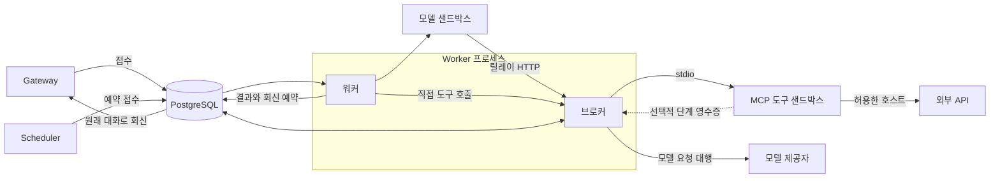

# 한 바이너리가 프로필을 읽고, 요청을 담당 에이전트에 전달한 뒤 원래 대화로 답한다.

일정을 묻는 CLI 요청을 예로 든다. 게이트웨이가 로컬 사용자를 확인해 접수하면 워커가 main을 실행한다. 모델이 agenda.list를 요청하면 브로커가 권한을 확인한 뒤 일정 도구를 실행한다. 예약도 같은 경로로 도구를 직접 부를 수 있다.

## 각 역할이 맡는 일

한 호스트에서 `bot serve --role all`을 실행하면 네 역할이 함께 시작한다. 역할별 프로세스로 실행하려면 `--role gateway`, `--role scheduler`, `--role worker` 또는 `--role admin`을 지정한다. 브로커는 워커에 포함된다.

- **Gateway**는 CLI·Slack·HTTP 요청을 신원, 프로필, 요청 ID, 회신 대상으로 변환한다. 인증·바인딩 확인 후 DB 커밋이 끝나면 접수를 알린다. 자기 어댑터 자격을 SecretStore에서 직접 받아 회신한다. 새 어댑터도 같은 접수·회신 계약을 따른다.
- **Scheduler**는 예정 시각마다 접수한다. **Worker**는 지시를 에이전트에 보내거나 도구를 직접 요청한다. 직계 자식에게 위임할 때 원래 주체·목적지와 좁아진 권한을 넘긴다. 부모는 대기 중 리스를 놓고 자식 성공·실패·취소 결과로 재개한다.
- **Broker**는 도구 호출을 인가하고 감사한다. 허가된 호출에 한해 MCP 서버를 시작한다. 모델용 채널은 외부 모델 이용도 중계한다. 도구의 외부 API 호출은 해당 서버가 맡는다.
- **Store**는 PG에 접수, 큐, 기억, 승인, 영수증, 회신을 기록한다. **Admin**은 axum UI/API로 권한에 맞는 실행·승인·보류를 보여 준다. OTLP는 요청·자식·시도·도구 ID를 잇는다. 추적 수집기 장애와 관계없이 원장은 보존한다.

핵심 용어는 프로필(격리 단위), 에이전트(역할 폴더), 스킬(지침·도구), 게이트웨이(입출구), 트리거(실행 조건), 실행(run), 브로커(도구 호출 관문), 효과(effect, 외부 쓰기) 여덟 개다.

### Claude Code가 브로커에 연결하는 방법

워커는 닻 VM으로 호스트 전용망을 유지하고 그 망에 연 릴레이의 실제 IP와 TCP 포트를 모델 VM의 신뢰된 init에 전달한다. 전용망 자체에서는 호스트의 다른 포트와 이웃 VM에도 닿는다. 모델 이미지의 init이 VM 방화벽을 먼저 설정하고 권한을 내려놓은 뒤 모델 CLI를 시작한다. CLI가 릴레이에 접속하면 브로커는 현재 실행의 리스(claim)에 묶인 세션 토큰을 확인한다.

| 요청 | 경로 | 인증 |
|---|---|---|
| 모델 응답 | `POST /v1/messages` (SSE 스트리밍 또는 JSON) | `ANTHROPIC_BASE_URL`은 브로커 주소, `ANTHROPIC_API_KEY`는 세션 토큰이다. 브로커가 상류 요청에 제공자 키를 넣는다. |
| 도구 조회·호출 | `POST /mcp` (MCP over HTTP) | `--bare --strict-mcp-config`로 실행한다. MCP 설정은 모델이 읽는 입력 폴더 밖(`/work/mcp.claude.json`)에 두고 헤더에는 `Authorization: Bearer ${RELAY_TOKEN}` 자리표시만 적는다. 같은 세션 토큰은 환경변수로만 전달하며 어떤 파일에도 쓰지 않는다. |

브로커는 도구 목록 조회에도 현재 claim을 확인한다. CLI가 보낸 `toolUseId`·도구 이름·인자를 저장된 모델 차례와 대조해 그 위치의 호출 ID를 사용한다. 워커 종료 시에는 자신에게 발급된 토큰만 회수한다. [CLI 재개 규약](reliability.md#cli가-승인이나-자식을-기다릴-때)

## 호스트 설정과 역할 조립

`BOT_HOST_CONFIG`에서 `models`는 프로필마다 허용한 모델 별칭이고, `providers`는 각 별칭의 실행 방법이다. 예를 들어 `{"models":{"personal":["assistant"]},"providers":{"assistant":{"kind":"demo"}}}`는 합성 일정에 외부 계정 없이 쓰는 설정 조각이다. `claude-cli`에는 상류 `model`, HTTPS `endpoint`, 프로필 자격 이름 `secret`이 필요하다. 서비스 키는 브로커가 상류에만 보낸다.

| 설정 | 용도와 기본값 |
|---|---|
| `sandbox.srt.binary`, `work_root` | 도구를 실행하는 역할은 고정된 srt와 읽기 전용 서버 설치본을 사용한다. 실행 파일과 작업 루트는 절대 경로다. |
| `sandbox.apple.image`, `sandbox.apple.network` | 모델 CLI 워커에 필요한 이미지 다이제스트와 호스트 전용 망 이름이다. 워커가 실행되는 동안 닻 VM이 이 망의 호스트 인터페이스를 유지한다. |
| `sandbox.apple.relay_bind` | 선택 사항. 기본값은 닻 VM이 확인한 게이트웨이 IPv4 주소와 OS가 배정하는 빈 포트다. 지정한 주소는 그 게이트웨이 IP와 일치해야 한다. |
| `sandbox.apple.work_root` | 선택 사항. 모델 작업 폴더의 절대 경로다. 워커 사용자만 접근하도록 준비한다(0700). 기본값은 도구 설치 폴더의 상위 디렉터리 아래 `work/models`다. |
| `sandbox.apple.instance` | 선택 사항. 이 워커가 관리하는 VM을 식별하는 이름과 접두사다. 기본값은 `botvm`이다. |
| `sandbox.apple.binary` | 선택 사항. 호스트의 Apple `container` 실행 파일을 절대 경로로 지정한다. 생략하면 `container`를 사용한다. |
| `bot/<profile>/private-intake` | 민감 DM을 받는 게이트웨이는 지정 도구의 실행기와 프로필별 지문 키가 있어야 시작한다. 지문 키는 도구 환경에 넣지 않는다. |

`sandbox.apple`에서 활성화 지문에 포함하는 값은 `image`와 `network`다. 둘 중 하나를 바꾸면 새 집합을 활성화해야 한다. `relay_bind`, `work_root`, `instance`, `binary`는 워커별 로컬 설정이다.

`admin.trace`(수집·OTLP) 설정도 활성화 지문에 포함한다(목적지·헤더·내용 허용·식별자 표기·표본 비율). 거두거나 바꾸면 새 집합을 활성화해야 하고, 옛 설정으로 남은 프로세스는 구판이 되어 내보내기를 멈춘다([관리 화면](admin.md#추적otlp)).

Rust 어댑터는 열린 리스너의 실제 주소 하나로 init용 `BOT_RELAY_IP`(RFC 1918 사설 IPv4)·`BOT_RELAY_PORT`(1~65535)와 Claude용 `ANTHROPIC_BASE_URL`(`http://IP:포트`)을 만든다. 호스트만 이 값을 설정한다. 모델 VM은 이미지 기본 진입점인 `bot-init`으로 시작하고, 닻 VM은 `bot-anchor`를 UID:GID `10001:10001`로 실행한다. [이미지와 어댑터의 실행 규약](model-image.md)

스케줄러는 예약만 접수한다. 데모 모델에는 VM이나 상류 서비스 키가 필요하지 않으며, 데모 도구에는 실제 도구와 같은 설치·격리·승인 규칙이 적용된다.

## Rust 크레이트

| 크레이트 | 책임 | 내부 의존 |
|---|---|---|
| bot-core | 공통 ID·상태·인터페이스 | 없음 |
| bot-profile | 프로필 탐색·검증·판본 생성 | core |
| bot-store | PG 큐·원장·회신 저장 | core |
| bot-runtime | 워커·예약·위임 및 Apple container VM에서 모델 CLI 실행 | core |
| bot-broker | 도구 인가·승인, 모델 프록시 및 srt에서 MCP 도구 실행 | core |
| bot-gateway | CLI·Slack·HTTP 접수와 회신 | core |
| bot-admin | 관리 API와 UI | core |
| bot-cli | bot 바이너리, SecretStore 구현과 역할 조립 | 위 7개 |

CLI는 공통 포트 `bot_core::sandbox::Sandbox<Spec>`에 모델용 Apple container VM과 도구 서버용 srt 어댑터를 각각 주입한다.

실행 설정은 BOT_ 접두사를 사용한다. 프로필 루트는 BOT_PROFILES로 주입한다. 공개 워크스페이스는 실제 프로필 이름·코드·경로에 의존하지 않는다.
