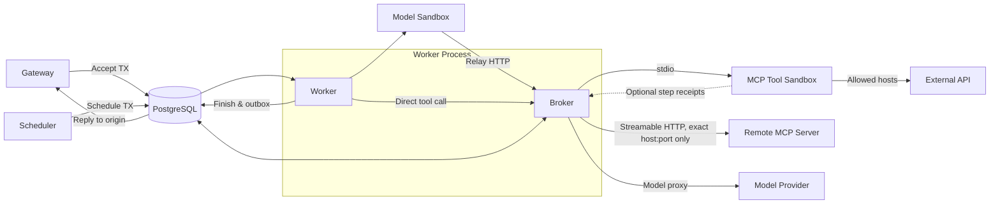
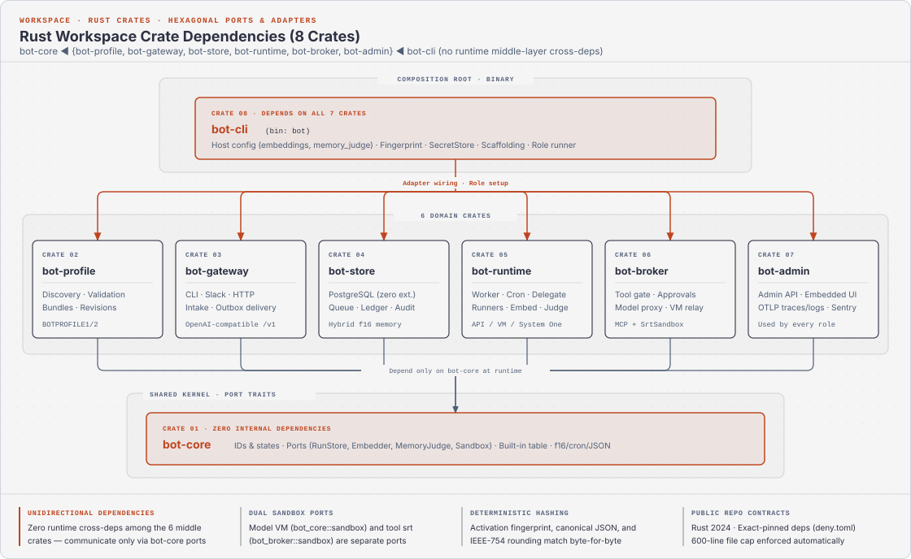

# Architecture

English | [한국어](ko/architecture.md)

One binary loads declarative profiles, routes each request to its target agent, executes tools through a single broker gate, and delivers replies back to the originating conversation.

For example, when a local CLI user asks for today's agenda, the gateway verifies identity and commits the request to PostgreSQL, a worker claims it for `main`, and when the model requests `agenda.list`, the broker checks permissions and runs the sandboxed tool. Scheduled triggers can invoke tools directly along the same broker path.

<picture>
  <source media="(prefers-color-scheme: dark)" srcset="diagrams/runtime-architecture-dark.svg">
  <source media="(prefers-color-scheme: light)" srcset="diagrams/runtime-architecture-light.svg">
  
</picture>

Text flow diagram (Mermaid)

## Runtime Roles

Start all four roles together on one host with `bot serve --role all`, or split them across processes using `--role gateway`, `--role scheduler`, `--role worker`, or `--role admin`. The broker runs inside the worker process.

- **Gateway:** Verifies and normalizes CLI, Slack, and HTTP requests into identity, profile, request ID, and reply target, then acknowledges only after PostgreSQL commits. Reads its own adapter credentials from `SecretStore` to deliver outbox replies.
- **Scheduler:** Commits runs on each due schedule tick.
- **Worker:** Claims queued runs and dispatches either a model turn or a direct tool call. Child delegation carries the original principal and reply target with narrowed scopes; the parent releases its lease while waiting and resumes on child completion, failure, or cancellation.
- **Broker:** Single authorization, approval, and audit gate (`Broker::call`). Launches local MCP servers in `srt` or connects directly to host-registered remote Streamable HTTP servers ([MCP Tools](plugins.md)). Also proxies upstream model calls for VM-hosted CLIs.
- **Store & Admin:** `bot-store` persists intake, queues, memory, approvals, receipts, and outbox rows in PostgreSQL. `bot-admin` serves the axum Admin UI/API scoped to caller permissions and exports OTLP traces/logs (linking request, child, attempt, and tool IDs) plus Sentry-compatible issues without affecting ledger durability if collectors fail.

The eight core concepts — **profile** (isolation unit), **agent** (role folder), **skill** (instructions + tools), **gateway** (ingress/egress), **trigger** (activation condition), **run** (unit of work), **broker** (tool gate), and **effect** (external write) — plus crate-specific code names are mapped in the [Glossary](glossary.md).

### How Claude Code Connects to the Broker

In `claude-cli` mode, the worker keeps a host-only network alive via an anchor VM and passes the relay listener's real IP and TCP port to the model VM's trusted `bot-init`. Because the private network can reach other host ports and peer VMs, `bot-init` installs the VM firewall first, drops privileges, and then launches the model CLI. Every relay request is authenticated with a session token bound to the run's active lease (`claim`).

The worker assembles agent instructions, skill bodies, and operator knowledge docs into read-only `/bot/AGENTS.md` and passes `--append-system-prompt-file /bot/AGENTS.md` on both fresh runs and `--resume`. Recalled memory is member-editable, so it is tagged with provenance and injected into user input (stdin on fresh runs; resumed session thereafter).

| Traffic | Endpoint | Auth & Isolation |
|---|---|---|
| Model completions | `POST /v1/messages` (SSE or JSON) | `ANTHROPIC_BASE_URL` points to the broker relay; `ANTHROPIC_API_KEY` holds the session token. The broker injects the real provider key only on the upstream hop. |
| Tool listing & calls | `POST /mcp` (MCP over HTTP) | Launched with `--bare --strict-mcp-config`. MCP config lives outside the model input dir (`/work/mcp.claude.json`) using `Authorization: Bearer ${RELAY_TOKEN}`; the token is passed via env var only and never written to disk. |

The broker verifies the active claim on tool listing as well, matches the CLI's `toolUseId`, tool name, and arguments against the saved model turn to assign deterministic call IDs, and revokes only tokens it issued on worker shutdown. ([Reliability](reliability.md))

## Host Configuration & Model Execution

In `BOT_HOST_CONFIG`, `models` declares allowed model aliases per profile, and `providers` defines how each alias runs — for example `{"models":{"personal":["assistant"]},"providers":{"assistant":{"kind":"demo"}}}` for the account-free local demo. A `claude-cli` provider requires upstream `model`, HTTPS `endpoint`, and profile secret name `secret`, with optional `effort` (`low`, `medium`, `high`, `xhigh`, `max`; defaults to `medium`) passed to `--effort`.

### Choosing a Model Runner

Use direct API runners (`anthropic-api`, `openai-api`) by default for chat and broker tools. Use `claude-cli` in an Apple `container` VM only when an agent declares `builtin: [read]` for isolated workspace file reads.

<picture>
  <source media="(prefers-color-scheme: dark)" srcset="diagrams/model-execution-paths-dark.svg">
  <source media="(prefers-color-scheme: light)" srcset="diagrams/model-execution-paths-light.svg">
  
</picture>

| Runner | Worker Host | Model Process | Provider Key Handling | Available Built-in Tools |
|---|---|---|---|---|
| `anthropic-api`, `openai-api` | Linux, macOS | None — worker calls upstream HTTP API directly without a VM. | Read from `SecretStore` immediately before sending and attached to the request header. May be omitted only for loopback endpoints. | Scope-capped `memory.share`, `schedule.create`, `schedule.list`, `schedule.cancel`; super-admin `skill.inspect`, `skill.create`, `skill.update`, `skill.delete`, `mcp.add`, `mcp.remove`; direct-child `delegate`. Declaring file built-ins fails permanently with `unsupported_builtin`. |
| `claude-cli` | macOS with Apple `container` | Disposable VM running Claude Code connected to the broker relay. | Read only by the host broker model proxy; VM receives a session token. | All tools above plus isolation-backed `read` when allowed by the profile. |

The host reserves `schedule.deliver` for per-firing delivery approvals. ([MCP Tools](plugins.md))

### Direct API Runners

The staged worker persists each turn's planned tool calls. If one call awaits approval, resumption replays the same plan, and pre-execution refusals replay by call ID. Non-delegation tools flow through the same `Broker::call` gate as the CLI front. ([Reliability](reliability.md))

- **Endpoints & parameters:** `anthropic-api` posts to `POST {endpoint}/v1/messages` (Anthropic Messages); `openai-api` posts to `POST {endpoint}/chat/completions` (`endpoint` includes `/v1`, supporting OpenAI, Gemini-compatible, Ollama, and vLLM). Example: `{"kind":"anthropic-api","model":"<upstream-id>","endpoint":"https://api.anthropic.com","secret":"<secret-name>","max_tokens":4096,"effort":"medium"}`.
  - Output cap: `max_tokens`, or `max_completion_tokens` on `openai-api` (specify at most one; sent verbatim so newer OpenAI models can use `max_completion_tokens` while compatible servers use `max_tokens`).
  - Optional `effort` (`low`, `medium`, `high`, `xhigh`, `max`): mapped to `output_config.effort` on `anthropic-api` and `reasoning_effort` on `openai-api`; omitted when unset.
- **Destination & stale-revision guard:** Only `https` is permitted, except `http` to loopback IP literals (`127.0.0.0/8`, `::1`, e.g., local Ollama). Hostname `localhost`, private-LAN `http`, embedded credentials (`user@`), queries, and fragments are rejected at config load; `secret` is optional only on loopback. Provider `kind`, `model`, full base `endpoint`, and `secret` name enter the activation fingerprint (`max_tokens`, `max_completion_tokens`, and `effort` do not). The worker verifies its active revision against the store **twice** — before reading the secret and immediately before sending (matching `GuardedUpstream` on the proxy path, without holding a guard across I/O). Stale workers discard any read key, skip transmission, and report transient `stale_worker` so the queue re-dispatches cleanly.
- **Transport & leak guard:** Redirects, hidden retries, and connection pooling are disabled, with connect, total (`Limits::total`), and response-body limits plus cancellation aborts. If the request's secret appears anywhere in the upstream response (raw or unescaped — final text, companion text, arguments, or provider state), nothing is checkpointed or sent to the broker and the run fails with `secret_in_response`.
- **Error classification (no runner retries; worker policy decides):**

| Failure Class | Fixed Codes | Triggers |
|---|---|---|
| Transient | `rate_limited`, `overloaded`, `network`, `timeout` | HTTP 429 (non-quota), 5xx, 408, connection failure, timeout |
| Permanent | `upstream_rejected`, `upstream_auth`, `upstream_redirect`, `invalid_response`, `output_limit`, `refused`, `content_filter` | HTTP 400/404/other 4xx, 401/403, 3xx, malformed payload, HTTP 429 with `error.code`/`error.type` in `insufficient_quota`/`quota_exhausted`, truncated output (`max_tokens`/`length`), `refusal`, content filter |

Error bodies are read up to 16 KiB solely for classification and never logged or stored; logs record only the HTTP status and fixed allowlisted reason code. Truncated tool calls are never executed.

- **Tool naming & schema validation:** Per request, tool IDs map reversibly to `^[a-zA-Z0-9_-]{1,64}$`. For Anthropic Messages, top-level `oneOf`/`allOf`/`anyOf` combinators in `input_schema` are flattened into branch properties and common required keys for upstream compatibility, while the broker still validates actual call arguments against the full original schema. Responses containing an unmapped name (`unknown_tool`), missing/non-object/oversized/duplicate-key args (`invalid_tool_args`), excessive calls (`too_many_calls`), duplicate upstream call IDs (`invalid_response`), or `tool_use` blocks when Anthropic did not stop with `tool_use` fail permanently without executing any call in that turn (args are never defaulted to `{}`).
- **Trust boundaries:** Only assembled system instructions enter the system role; user messages, `tool_result`/`tool` outputs, and recalled memory stay in user/tool roles.
- **Usage accounting:** Only tokens explicitly reported by upstream are recorded (never zero-filled). Totals are stored only when every model call reported usage, the run is on its first claim, and no delegation actually spawned a child. Unreported calls omit token attributes from `worker.model` spans. Per-turn counts survive approval checkpoints.
- **Opaque provider state:** Upstream call IDs and reasoning state (`extra_content.google.thought_signature` on OpenAI-compatible Gemini; `thinking`/`redacted_thinking` blocks and `tool_use` IDs on Anthropic) are stored opaquely alongside idempotent worker call IDs and bound to the provider fingerprint (`kind`, base URL, `model`, `secret`). If the alias target changes while paused, stale provider state is not forwarded to the new upstream. Oversized reasoning/signature payloads fail permanently with `unsupported_tool_signature` before executing any call.

### Host Settings Summary

| Setting | Purpose & Defaults |
|---|---|
| `sandbox.srt.binary`, `work_root`, `extra_path` | Absolute paths for `srt` binary and read-only tool install/work root. Optional `extra_path` appends up to 16 absolute host directories (e.g., `/opt/homebrew/bin`) to sandboxed tools' `PATH`. |
| `limits.tool_call_max_secs` | Optional ceiling in seconds for per-tool `timeout_secs` (default `60`, max `900`). Raising the ceiling does not raise the 60 s default for tools omitting `timeout_secs`. Included in activation fingerprint. ([MCP Tools](plugins.md)) |
| `sandbox.apple.image`, `sandbox.apple.network` | Pinned image digest and host-only network name for `claude-cli` workers (anchor VM holds the host interface). Included in activation fingerprint. |
| `sandbox.apple.relay_bind` | Optional worker-local relay bind address; defaults to the anchor VM's gateway IPv4 with an OS-assigned port and must match that gateway IP if set. |
| `sandbox.apple.work_root` | Optional worker-local absolute dir for model workdirs (`0700`); defaults to `<tool-root-parent>/work/models`. |
| `sandbox.apple.instance` | Optional worker-local VM name prefix (default `botvm`). |
| `sandbox.apple.binary` | Optional worker-local absolute path to Apple `container` binary (default `container`). |
| `bot/<profile>/private-intake` | Required per-profile fingerprint key (plus configured tool runner) for gateways accepting private DMs; never injected into tool environments. |
| `admin.trace`, `admin.logs`, `admin.issues` | OTLP trace/log and Sentry-compatible issue exporter settings (endpoints, headers, secrets, levels, content flags, ID format, sample rates). Included in activation fingerprint; changing or removing requires re-activation so stale processes stop exporting. ([Admin & Observability](admin.md)) |

From the relay listener's real address, the Rust adapter derives `BOT_RELAY_IP` (RFC 1918 IPv4), `BOT_RELAY_PORT` (`1..=65535`), and `ANTHROPIC_BASE_URL` (`http://IP:port`) on the host only. Model VMs boot `bot-init`; anchor VMs run `bot-anchor` as UID:GID `10001:10001`. ([Model Image](model-image.md))

The demo model needs no VM or upstream key, while demo tools enforce the same install, sandbox, and approval rules as production tools.

## Rust Workspace Crates

<picture>
  <source media="(prefers-color-scheme: dark)" srcset="diagrams/crate-dependencies-dark.svg">
  <source media="(prefers-color-scheme: light)" srcset="diagrams/crate-dependencies-light.svg">
  
</picture>

| Crate | Responsibility | Internal Dependencies |
|---|---|---|
| `bot-core` | Shared IDs, state types, port traits, built-in tool table, deterministic algorithms | None |
| `bot-profile` | Profile discovery, validation, bundle packing, and revision creation | `bot-core` |
| `bot-store` | PostgreSQL queue, call/effect ledger, approvals, outbox, and audit chain | `bot-core` |
| `bot-runtime` | Worker loop, scheduler, delegation, direct API (`anthropic-api`, `openai-api`), and Apple `container` VM CLI runners | `bot-core` |
| `bot-broker` | Tool authorization, approvals, model proxy, VM relay, and `srt`-sandboxed MCP runner | `bot-core` |
| `bot-gateway` | CLI, Slack, and HTTP (OpenAI-compatible) intake and outbox delivery | `bot-core` |
| `bot-admin` | Admin API/UI and OTLP trace/log + Sentry-compatible issue exporters (used by every role) | `bot-core` |
| `bot-cli` | `bot` binary, host configuration, `SecretStore` implementations, and role wiring | All 7 above |

There are two separate sandbox ports with no shared parent trait: `ContainerSandbox` implements `bot_core::sandbox::Sandbox<ModelSpec>` for model VMs, while `SrtSandbox` implements `bot_broker::sandbox::Sandbox` for MCP tools; `bot-cli` injects each adapter independently.

Runtime environment variables use the `BOT_` prefix, and profile directories are supplied via `BOT_PROFILES`. The public workspace has no hardcoded profile names, paths, or private identifiers.
