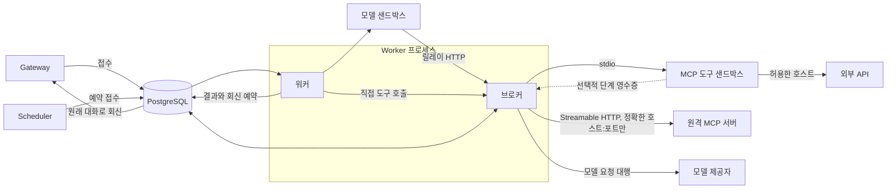

# 한 바이너리가 프로필을 읽고, 요청을 담당 에이전트에 전달한 뒤 원래 대화로 답한다.

일정을 묻는 CLI 요청을 예로 든다. 게이트웨이가 로컬 사용자를 확인해 접수하면 워커가 main을 실행한다. 모델이 agenda.list를 요청하면 브로커가 권한을 확인한 뒤 일정 도구를 실행한다. 예약도 같은 경로로 도구를 직접 부를 수 있다.

## 각 역할이 맡는 일

한 호스트에서 `bot serve --role all`을 실행하면 네 역할이 함께 시작한다. 역할별 프로세스로 실행하려면 `--role gateway`, `--role scheduler`, `--role worker` 또는 `--role admin`을 지정한다. 브로커는 워커에 포함된다.

- **Gateway**는 CLI·Slack·HTTP 요청을 신원, 프로필, 요청 ID, 회신 대상으로 변환한다. 인증·바인딩 확인 후 DB 커밋이 끝나면 접수를 알린다. 자기 어댑터 자격을 SecretStore에서 직접 받아 회신한다. 새 어댑터도 같은 접수·회신 계약을 따른다.
- **Scheduler**는 예정 시각마다 접수한다. **Worker**는 지시를 에이전트에 보내거나 도구를 직접 요청한다. 직계 자식에게 위임할 때 원래 주체·목적지와 좁아진 권한을 넘긴다. 부모는 대기 중 리스를 놓고 자식 성공·실패·취소 결과로 재개한다.
- **Broker**는 도구 호출을 인가하고 감사한다. 허가된 호출에 한해 MCP 서버를 시작하거나, 호스트에 등록한 원격(Streamable HTTP) 서버에 직접 접속한다([원격 도구 서버](plugins.md#원격-도구-서버streamable-http)). 모델용 채널은 외부 모델 이용도 중계한다. 도구의 외부 API 호출은 해당 서버가 맡는다.
- **Store**는 PG에 접수, 큐, 기억, 승인, 영수증, 회신을 기록한다. **Admin**은 axum UI/API로 권한에 맞는 실행·승인·보류를 보여 준다. OTLP는 요청·자식·시도·도구 ID를 잇는다. 추적 수집기 장애와 관계없이 원장은 보존한다.

핵심 용어는 프로필(격리 단위), 에이전트(역할 폴더), 스킬(지침·도구), 게이트웨이(입출구), 트리거(실행 조건), 실행(run), 브로커(도구 호출 관문), 효과(effect, 외부 쓰기) 여덟 개다. 코드 이름과 크레이트마다 다르게 쓰이는 말은 [용어집](glossary.md)에 모았다.

### Claude Code가 브로커에 연결하는 방법

워커는 닻 VM으로 호스트 전용망을 유지하고 그 망에 연 릴레이의 실제 IP와 TCP 포트를 모델 VM의 신뢰된 init에 전달한다. 전용망 자체에서는 호스트의 다른 포트와 이웃 VM에도 닿는다. 모델 이미지의 init이 VM 방화벽을 먼저 설정하고 권한을 내려놓은 뒤 모델 CLI를 시작한다. CLI가 릴레이에 접속하면 브로커는 현재 실행의 리스(claim)에 묶인 세션 토큰을 확인한다.

워커는 에이전트 지침, 스킬 지침, 운영자가 배포한 지식 문서를 읽기 전용 파일 `/bot/AGENTS.md`에 조립한다. 새 실행과 재개(`--resume`) 모두 `--append-system-prompt-file /bot/AGENTS.md`를 지정해 Claude의 시스템 지침에 추가한다.

회상한 기억은 회원이 수정할 수 있으므로, 워커가 출처를 표시해 사용자 입력에 참고 자료로 넣는다. 새 실행은 이 입력을 표준입력으로 보내고, 재개할 때는 저장한 세션을 이어 간다.

| 요청 | 경로 | 인증 |
|---|---|---|
| 모델 응답 | `POST /v1/messages` (SSE 스트리밍 또는 JSON) | `ANTHROPIC_BASE_URL`은 브로커 주소, `ANTHROPIC_API_KEY`는 세션 토큰이다. 브로커가 상류 요청에 제공자 키를 넣는다. |
| 도구 조회·호출 | `POST /mcp` (MCP over HTTP) | `--bare --strict-mcp-config`로 실행한다. MCP 설정은 모델이 읽는 입력 폴더 밖(`/work/mcp.claude.json`)에 두고 헤더에는 `Authorization: Bearer ${RELAY_TOKEN}` 자리표시만 적는다. 같은 세션 토큰은 환경변수로만 전달하며 어떤 파일에도 쓰지 않는다. |

브로커는 도구 목록 조회에도 현재 claim을 확인한다. CLI가 보낸 `toolUseId`·도구 이름·인자를 저장된 모델 차례와 대조해 그 위치의 호출 ID를 사용한다. 워커 종료 시에는 자신에게 발급된 토큰만 회수한다. [CLI 재개 규약](reliability.md#cli가-승인이나-자식을-기다릴-때)

## 호스트 설정과 역할 조립

`BOT_HOST_CONFIG`에서 `models`는 프로필마다 허용한 모델 별칭이고, `providers`는 각 별칭의 실행 방법이다. 예를 들어 `{"models":{"personal":["assistant"]},"providers":{"assistant":{"kind":"demo"}}}`는 합성 일정에 외부 계정 없이 쓰는 설정 조각이다. `claude-cli`에는 상류 `model`, HTTPS `endpoint`, 프로필 자격 이름 `secret`이 필요하다. 서비스 키는 브로커가 상류에만 보낸다.

### 모델 실행기 선택

| 실행기 | 워커 호스트 | 모델 프로세스 | 사용할 수 있는 내장 도구 |
|---|---|---|---|
| `anthropic-api` · `openai-api` | Linux · macOS | 워커가 상류 API에 HTTPS 요청을 보낸다. 워커에서 모델 프로세스를 띄우지 않는다. | `memory.share`, `schedule.create/list/cancel`, 직계 자식이 있으면 `delegate`. 파일 도구를 선언하면 `unsupported_builtin`으로 종료한다. |
| `claude-cli` | Apple `container`를 실행할 수 있는 macOS | 실행별 VM에서 Claude Code를 띄우고 브로커 릴레이로 연결한다. | 같은 기억·예약·위임 도구. 프로필에서 허용하고 샌드박스가 격리를 보증하면 VM의 `read`도 쓸 수 있다. |

**API 직접 호출(`anthropic-api`·`openai-api`).** 워커는 모델 차례와 호출 계획을 저장한다. 여러 도구 중 하나가 승인을 기다리면 같은 계획에서 재개하고, 실행 전 확정 거절은 호출 ID로 재생한다. `schedule.deliver`는 호스트가 발화별 전송 승인을 처리할 때만 쓴다. [모델 실행기가 받는 내장 도구](plugins.md#모델-실행기가-받는-내장-도구)

`anthropic-api`는 `POST {endpoint}/v1/messages`(Anthropic Messages), `openai-api`는 `POST {endpoint}/chat/completions`(OpenAI 호환: OpenAI·Gemini 호환·Ollama·vLLM, `endpoint`는 `/v1`까지 포함한 기준 주소)다. 예: `{"kind":"anthropic-api","model":"<상류 모델 ID>","endpoint":"https://api.anthropic.com","secret":"<자격 이름>","max_tokens":4096}`. 출력 한도는 `max_tokens`이고, `openai-api`는 `max_completion_tokens`도 쓸 수 있다(둘 중 하나만, 적힌 이름 그대로 보낸다. OpenAI 공식 API의 새 모델은 `max_completion_tokens`만 받고 Ollama·vLLM·Gemini 호환 같은 호환 서버는 대개 `max_tokens`를 받는다). 모델은 호스트 파일·셸에 닿지 못하고 도구는 지금처럼 워커가 `Broker::call`(인가·승인·샌드박스·원장·감사)로만 부른다. 설정과 동작 규칙은 다음과 같다.

- **목적지.** `https`만 쓴다. `http`는 호스트가 loopback IP 리터럴(127.0.0.0/8·`::1`)일 때만 받는다(로컬 Ollama). `localhost` 이름·사설망 `http`·자격(`user@`)·쿼리·조각이 있는 주소는 설정 단계에서 거절한다. `secret`은 loopback 주소에서만 생략할 수 있다. 종류·모델·기준 주소 전체·자격 이름은 활성화 지문에 들어가고(`max_tokens`는 아니다), 워커는 이 프로세스의 활성화 판본이 저장소의 활성 판본인지 키를 읽기 전과 키를 읽은 뒤 보내기 직전에 **두 번** 확인한다(기존 모델 중계 경로의 `GuardedUpstream`과 같은 규칙이고 그 경로도 전송 동안 가드를 쥐지 않는다). 구판은 철회된 목적지로 대화도 키도 보내지 않고 키를 읽지도 않으며, 키를 읽는 사이에 판본이 바뀌면 읽은 키를 버리고 보내지 않는다. 일시 오류(`stale_worker`)로 보고하면 저장소가 구판의 시도를 쓰지 않고 대기열로 돌려준다.
- **전송.** 리다이렉트·숨은 재시도·연결 재사용을 끄고 연결 시간·전체 시간(`Limits::total`)·본문 크기 상한을 둔다. 취소 신호가 오면 요청을 끊는다. 키는 보내는 순간 보관소에서 읽어 요청 머리에만 싣고 비밀로 표시한다. 해당 요청의 키가 상류 응답(원문과, 이스케이프를 풀어 읽은 모든 글 — 최종 글·호출과 함께 온 글·인자·공급자 상태 포함)에 있으면 체크포인트·브로커에 아무것도 넘기지 않고 `secret_in_response`로 끝낸다.
- **분류.** 실행기는 스스로 다시 보내지 않는다. 429(`rate_limited`)·5xx(`overloaded`)·408·연결 실패·시간 초과(`network`·`timeout`)는 일시 오류, 400·404·그 밖의 4xx(`upstream_rejected`)·401·403(`upstream_auth`)·3xx(`upstream_redirect`)·응답 모양 불일치(`invalid_response`)·쿼터 소진(429인데 본문의 `error.code`·`error.type`이 `insufficient_quota`, `quota_exhausted`)은 영구 실패다. 429 본문은 작은 상한 안에서만 읽고 어디에도 남기지 않으며, 오류 상태 로그에는 상태 코드와 허용 목록의 고정 분류 낱말만 싣는다. 다시 할지는 워커 정책이 정한다. 출력 한도에서 끊긴 응답(`max_tokens`·`length`)은 부분 글이나 잘린 호출을 쓰지 않고 `output_limit`으로 끝낸다(잘린 도구 호출은 실행하지 않는다). 거절(`refusal`)·콘텐츠 필터는 `refused`·`content_filter`다.
- **도구 이름과 스키마.** 상류 규칙(`^[a-zA-Z0-9_-]{1,64}$`)에 맞게 요청마다 되돌릴 수 있는 별칭표를 만든다. Anthropic Messages API는 도구 `input_schema` 최상위에서 `oneOf`·`allOf`·`anyOf`를 받지 않으므로, 상류 전송본에서는 최상위 조합자만 풀어 분기 속성·공통 필수 키를 끌어올리고 실제 호출 인자는 브로커가 프로필 원본 스키마 전체로 다시 검증한다. 응답의 이름은 이 표로 정확히 도구 ID로 되돌린다. 표에 없는 이름(`unknown_tool`)·없거나 객체가 아니거나 큰 인자, 같은 키가 두 번 나오는 인자(`invalid_tool_args`)·너무 많은 호출(`too_many_calls`)·한 응답 안의 같은 상류 호출 ID(`invalid_response`)·Anthropic에서 `tool_use`로 끝나지 않은 응답의 `tool_use` 블록은 그 차례의 도구를 하나도 부르지 않고 영구 실패로 끝낸다. 인자는 빈 객체로 짐작하지 않는다.
- **신뢰 경계.** 맥락 조립이 준 시스템 글만 시스템 자리에 간다. 사용자 줄·도구 결과(`tool_result`·`tool` 역할)·회상 기억은 사용자 영역에만 간다.
- **사용량.** 응답이 실제로 보고한 토큰만 쓴다(없으면 없음, 0으로 채우지 않는다). 모든 모델 요청이 보고됐고 이 run이 첫 claim이며 **실제로 자식을 만든** 위임이 없을 때만 합계를 저장한다(자식을 만들지 못한 위임 실패는 해당하지 않는다). 보고하지 않은 요청의 `worker.model` 스팬에는 토큰 속성을 적지 않는다(0으로 채우지 않는다). 차례마다의 기록은 계획 체크포인트에 남아 승인 대기 뒤 재개에서도 이어진다.
- **공급자 상태.** 도구 호출과 함께 온 상류의 호출 ID와 사고 서명(Gemini 계열의 `extra_content.google.thought_signature`)은 워커의 멱등 호출 ID와 따로 불투명 상태로 체크포인트에 남았다가 같은 공급자에 같은 호출 자리로 되돌려진다. 승인 대기 뒤 재개에서도 그대로다. 상태에는 그것을 준 공급자의 지문(종류·기준 주소·모델·자격 이름)이 묶여 있어, 대기 동안 같은 별칭의 목적지가 바뀌면 옛 공급자의 ID·서명은 새 공급자에 실리지 않는다(서명이 필요한 모델이면 그 상류가 거절해 고정 코드로 끝난다). 서명이 너무 크면 호출을 하나도 부르지 않고 `unsupported_tool_signature`로 끝낸다.

| 설정 | 용도와 기본값 |
|---|---|
| `sandbox.srt.binary`, `work_root`, `extra_path` | 도구를 실행하는 역할은 고정된 srt와 읽기 전용 서버 설치본을 사용한다. 실행 파일과 작업 루트는 절대 경로다. 선택 항목 `extra_path`는 샌드박스 안 도구의 `PATH`에 추가할 호스트 절대 폴더 목록(최대 16개, 예: `/opt/homebrew/bin`)이다. |
| `limits.tool_call_max_secs` | 선택 사항. 도구가 `timeout_secs`로 선언할 수 있는 호출 시간 한도(초)의 천장이다. 기본 60, 최대 900이다. 천장만 올려도 선언하지 않은 도구의 한도는 60초다. 값은 활성화 지문에 들어간다. [도구 호출 시간 한도](plugins.md#일반-호출) |
| `sandbox.apple.image`, `sandbox.apple.network` | 모델 CLI 워커에 필요한 이미지 다이제스트와 호스트 전용 망 이름이다. 워커가 실행되는 동안 닻 VM이 이 망의 호스트 인터페이스를 유지한다. |
| `sandbox.apple.relay_bind` | 선택 사항. 기본값은 닻 VM이 확인한 게이트웨이 IPv4 주소와 OS가 배정하는 빈 포트다. 지정한 주소는 그 게이트웨이 IP와 일치해야 한다. |
| `sandbox.apple.work_root` | 선택 사항. 모델 작업 폴더의 절대 경로다. 워커 사용자만 접근하도록 준비한다(0700). 기본값은 도구 설치 폴더의 상위 디렉터리 아래 `work/models`다. |
| `sandbox.apple.instance` | 선택 사항. 이 워커가 관리하는 VM을 식별하는 이름과 접두사다. 기본값은 `botvm`이다. |
| `sandbox.apple.binary` | 선택 사항. 호스트의 Apple `container` 실행 파일을 절대 경로로 지정한다. 생략하면 `container`를 사용한다. |
| `bot/<profile>/private-intake` | 민감 DM을 받는 게이트웨이는 지정 도구의 실행기와 프로필별 지문 키가 있어야 시작한다. 지문 키는 도구 환경에 넣지 않는다. |

`sandbox.apple`에서 활성화 지문에 포함하는 값은 `image`와 `network`다. 둘 중 하나를 바꾸면 새 집합을 활성화해야 한다. `relay_bind`, `work_root`, `instance`, `binary`는 워커별 로컬 설정이다.

`admin.trace`(수집·OTLP) 설정도 활성화 지문에 포함한다(목적지·헤더·내용 허용·식별자 표기·표본 비율). 거두거나 바꾸면 새 집합을 활성화해야 하고, 옛 설정으로 남은 프로세스는 구판이 되어 내보내기를 멈춘다([관리 화면](admin.md#추적otlp)).

Rust 어댑터는 열린 리스너의 실제 주소 하나로 init용 `BOT_RELAY_IP`(RFC 1918 사설 IPv4)·`BOT_RELAY_PORT`(1~65535)와 Claude용 `ANTHROPIC_BASE_URL`(`http://IP:포트`)을 만든다. 호스트만 이 값을 설정한다. 모델 VM은 이미지 기본 진입점인 `bot-init`으로 시작하고, 닻 VM은 `bot-anchor`를 UID:GID `10001:10001`로 실행한다. [이미지와 어댑터의 실행 규약](model-image.md)

스케줄러는 예약만 접수한다. 데모 모델에는 VM이나 상류 서비스 키가 필요하지 않으며, 데모 도구에는 실제 도구와 같은 설치·격리·승인 규칙이 적용된다.

## Rust 크레이트

| 크레이트 | 책임 | 내부 의존 |
|---|---|---|
| bot-core | 공통 ID·상태·인터페이스 | 없음 |
| bot-profile | 프로필 탐색·검증·판본 생성 | core |
| bot-store | PG 큐·원장·회신 저장 | core |
| bot-runtime | 워커·예약·위임 및 Apple container VM에서 모델 CLI 실행 | core |
| bot-broker | 도구 인가·승인, 모델 프록시 및 srt에서 MCP 도구 실행 | core |
| bot-gateway | CLI·Slack·HTTP 접수와 회신 | core |
| bot-admin | 관리 API·UI와 OTLP 추적 내보내기(모든 역할이 쓴다) | core |
| bot-cli | bot 바이너리, SecretStore 구현과 역할 조립 | 위 7개 |

샌드박스 포트는 둘이다. 모델용 Apple container VM(`ContainerSandbox`)은 `bot_core::sandbox::Sandbox<ModelSpec>`을, 도구 서버용 srt(`SrtSandbox`)는 이름만 같은 별개의 `bot_broker::sandbox::Sandbox`를 구현한다. 둘을 묶는 공통 포트는 없고, CLI가 각각의 어댑터를 주입한다.

실행 설정은 BOT_ 접두사를 사용한다. 프로필 루트는 BOT_PROFILES로 주입한다. 공개 워크스페이스는 실제 프로필 이름·코드·경로에 의존하지 않는다.
