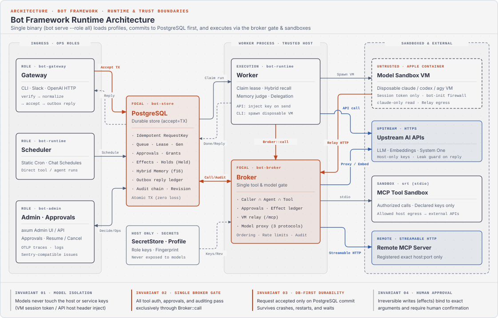
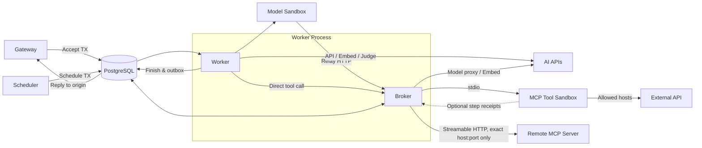
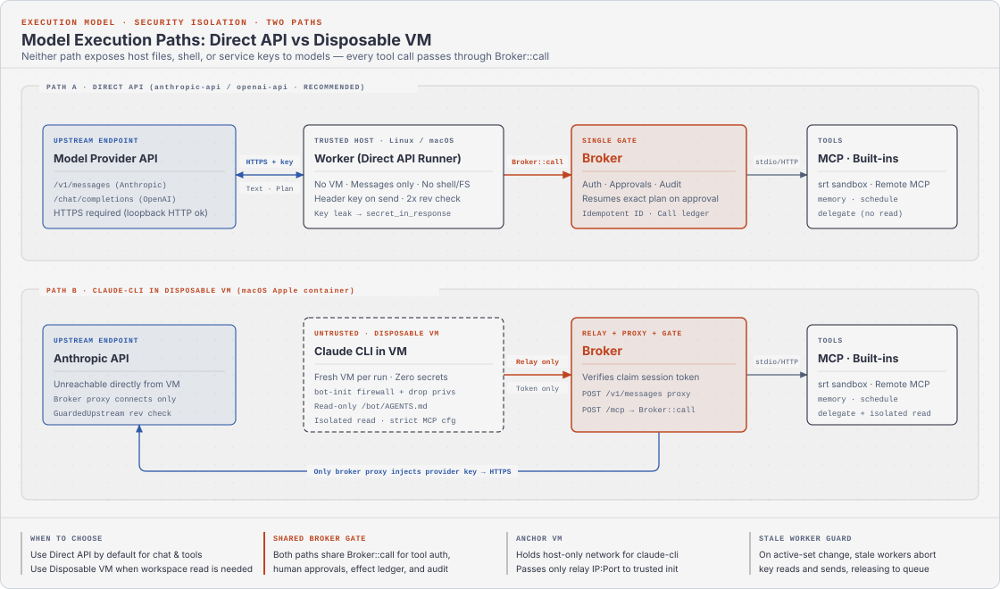
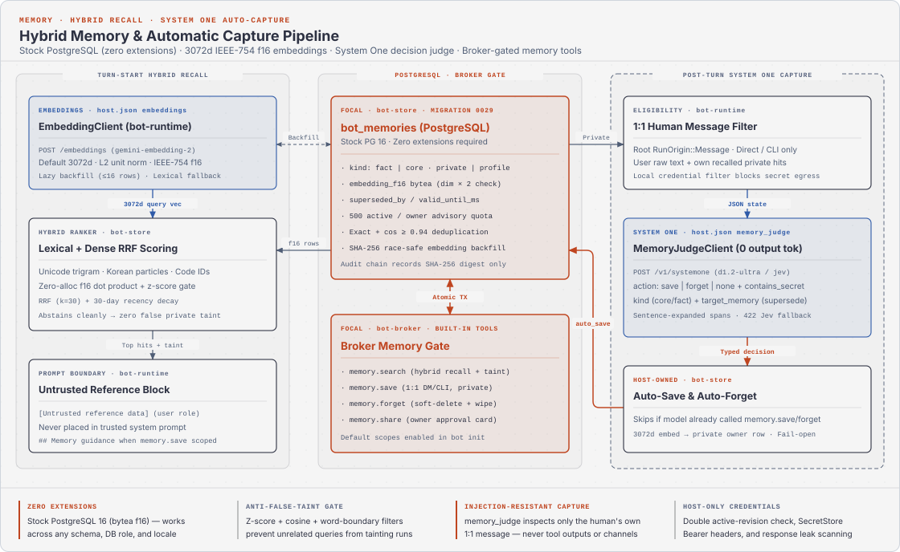
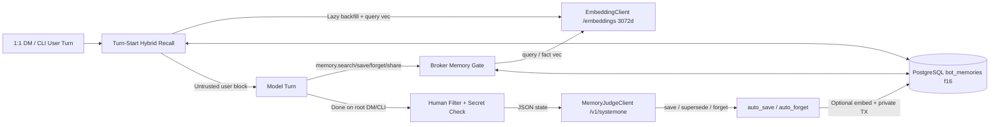

# Architecture

English | [한국어](ko/architecture.md)

One binary loads declarative profiles, routes each request to its target agent, executes tools through a single broker gate, and delivers replies back to the originating conversation.

For example, when a local CLI user asks for today's agenda, the gateway verifies identity and commits the request to PostgreSQL, a worker claims it for `main`, and when the model requests `agenda.list`, the broker checks permissions and runs the sandboxed tool. Scheduled triggers can invoke tools directly along the same broker path.

<picture>
  <source media="(prefers-color-scheme: dark)" srcset="diagrams/runtime-architecture-dark.svg">
  <source media="(prefers-color-scheme: light)" srcset="diagrams/runtime-architecture-light.svg">
  
</picture>

Text flow diagram (Mermaid)

## Runtime Roles

Start all four roles together on one host with `bot serve --role all`, or split them across processes using `--role gateway`, `--role scheduler`, `--role worker`, or `--role admin`. The broker runs inside the worker process.

- **Gateway:** Verifies and normalizes CLI, Slack, and HTTP requests into identity, profile, request ID, and reply target, then acknowledges only after PostgreSQL commits. Reads its own adapter credentials from `SecretStore` to deliver outbox replies.
- **Scheduler:** Commits runs on each due schedule tick.
- **Worker:** Claims queued runs and dispatches either a model turn or a direct tool call. Child delegation carries the original principal and reply target with narrowed scopes; the parent releases its lease while waiting and resumes on child completion, failure, or cancellation.
- **Broker:** Single authorization, approval, and audit gate (`Broker::call`). Launches local MCP servers in `srt` or connects directly to host-registered remote Streamable HTTP servers ([MCP Tools](plugins.md)). Also proxies upstream model calls for VM-hosted CLIs.
- **Store & Admin:** `bot-store` persists intake, queues, memory, approvals, receipts, and outbox rows in PostgreSQL. `bot-admin` serves the axum Admin UI/API scoped to caller permissions and exports OTLP traces/logs (linking request, child, attempt, and tool IDs) plus Sentry-compatible issues without affecting ledger durability if collectors fail.

The eight core concepts — **profile** (isolation unit), **agent** (role folder), **skill** (instructions + tools), **gateway** (ingress/egress), **trigger** (activation condition), **run** (unit of work), **broker** (tool gate), and **effect** (external write) — plus crate-specific code names are mapped in the [Glossary](glossary.md).

### How VM-Hosted Model CLIs Connect to the Broker

In VM CLI mode (`claude-cli`, `codex-cli`, `agy-cli`), the worker keeps a host-only network alive via a shared anchor VM and passes the relay listener's real IP and TCP port to the model VM's trusted `bot-init`. Because the private network can reach other host ports and peer VMs, `bot-init` installs the VM firewall first, drops privileges, and then launches the pinned model CLI. Every relay request is authenticated with a session token bound to the run's active lease (`claim`) and pinned to that alias's wire protocol.

The worker assembles agent instructions, skill bodies, and operator knowledge docs into read-only `/bot/AGENTS.md` (loaded via `--append-system-prompt-file /bot/AGENTS.md` on `claude-cli` and auto-loaded from `/bot` on `codex-cli` and `agy-cli`, with `agy-cli` spilling tool schemas into stdin when needed to stay within its 24 KB rule limit). Recalled memory is member-editable, so it is tagged with provenance and injected into user input rather than trusted system instructions.

| CLI Runner | Model Relay Route | Tool Relay & Auth | Recovery & Resume |
|---|---|---|---|
| `claude-cli` | `POST /v1/messages` (`Anthropic`, `ANTHROPIC_BASE_URL` / `ANTHROPIC_API_KEY`) | `POST /mcp` via `/work/mcp.claude.json` (`Bearer ${RELAY_TOKEN}`); matches `_meta["claudecode/toolUseId"]`. | Audited JSONL session tail + `--resume` with broker-recalled tool outputs. |
| `codex-cli` | `POST /v1/responses` (`OpenAiResponses`, `Authorization: Bearer ${RELAY_TOKEN}`) | `POST /mcp` via `mcp_servers.relay.bearer_token_env_var="RELAY_TOKEN"`; matches `_meta["callId"]`. | Audited rollout JSONL tail + `codex exec resume` with broker-recalled tool outputs. |
| `agy-cli` | `POST /v1beta/models/<model>:streamGenerateContent` / `:generateContent` (`Gemini`, `GOOGLE_GEMINI_BASE_URL` / `GEMINI_API_KEY`) | `POST /mcp` via symlink to RAM-only `/tmp/mcp_config.json` expanded by `bot-init` from `/work/mcp.agy.template.json`; broker matches `call_mcp_tool` plans FIFO by `_meta["progressToken"]`. | Broker commits `cli-group-*` / `cli-use-*` directly; park/resume settles ledger slots and launches a fresh session with rendered exchanges. |

In every CLI mode, the broker injects the real upstream provider key only on the outbound proxy hop, verifies the active claim on tool listing as well, matches every `/mcp` call against broker-observed model turns before assigning deterministic call IDs, and revokes only tokens it issued on worker shutdown. ([Reliability](reliability.md))

## Host Configuration & Model Execution

In `BOT_HOST_CONFIG`, `models` declares allowed model aliases per profile, and `providers` defines how each alias runs — for example `{"models":{"personal":["assistant"]},"providers":{"assistant":{"kind":"demo"}}}` for the account-free local demo. VM CLI providers (`claude-cli`, `codex-cli`, `agy-cli`) require upstream `model`, HTTPS `endpoint`, and profile secret name `secret`, with optional `effort` (`low`, `medium`, `high`, `xhigh`, `max`; defaults to `medium`).

### Choosing a Model Runner

Use direct API runners (`anthropic-api`, `openai-api`) by default for chat and broker tools. Use VM-hosted CLI runners (`claude-cli`, `codex-cli`, `agy-cli`) in an Apple `container` VM when you want a CLI agent harness (or `claude-cli` when an agent declares `builtin: [read]` for isolated `/bot` file reads).

<picture>
  <source media="(prefers-color-scheme: dark)" srcset="diagrams/model-execution-paths-dark.svg">
  <source media="(prefers-color-scheme: light)" srcset="diagrams/model-execution-paths-light.svg">
  
</picture>

| Runner | Worker Host | Model Process | Provider Key Handling | Available Built-in Tools |
|---|---|---|---|---|
| `anthropic-api`, `openai-api` | Linux, macOS | None — worker calls upstream HTTP API directly without a VM. | Read from `SecretStore` immediately before sending and attached to the request header. May be omitted only for loopback endpoints. | Scope-capped `memory.share`, `memory.search`, `memory.save`, `memory.forget`, `schedule.create`, `schedule.list`, `schedule.cancel`; super-admin `skill.inspect`, `skill.create`, `skill.update`, `skill.delete`, `mcp.add`, `mcp.remove`; direct-child `delegate`. Declaring file built-ins fails permanently with `unsupported_builtin`. |
| `claude-cli` | macOS with Apple `container` | Disposable VM running Claude Code connected to the broker relay. | Read only by the host broker model proxy; VM receives a session token. | All tools above plus isolation-backed `read` when allowed by the profile. |
| `codex-cli`, `agy-cli` | macOS with Apple `container` | Disposable VM running Codex CLI or Antigravity CLI connected to the broker relay. | Read only by the host broker model proxy; VM receives a session token. | All broker tools above. Declaring file built-ins (`read`, `grep`, `glob`) fails with `unsupported_builtin`. |

The host reserves `schedule.deliver` for per-firing delivery approvals. ([MCP Tools](plugins.md))

### Direct API Runners

The staged worker persists each turn's planned tool calls. If one call awaits approval, resumption replays the same plan, and pre-execution refusals replay by call ID. Non-delegation tools flow through the same `Broker::call` gate as the CLI front. ([Reliability](reliability.md))

- **Endpoints & parameters:** `anthropic-api` posts to `POST {endpoint}/v1/messages` (Anthropic Messages); `openai-api` posts to `POST {endpoint}/chat/completions` (`endpoint` includes `/v1`, supporting OpenAI, Gemini-compatible, Ollama, and vLLM). Example: `{"kind":"anthropic-api","model":"<upstream-id>","endpoint":"https://api.anthropic.com","secret":"<secret-name>","max_tokens":4096,"effort":"medium"}`.
  - Output cap: `max_tokens`, or `max_completion_tokens` on `openai-api` (specify at most one; sent verbatim so newer OpenAI models can use `max_completion_tokens` while compatible servers use `max_tokens`).
  - Optional `effort` (`low`, `medium`, `high`, `xhigh`, `max`): mapped to `output_config.effort` on `anthropic-api` and `reasoning_effort` on `openai-api`; omitted when unset.
- **Destination & stale-revision guard:** Only `https` is permitted, except `http` to loopback IP literals (`127.0.0.0/8`, `::1`, e.g., local Ollama). Hostname `localhost`, private-LAN `http`, embedded credentials (`user@`), queries, and fragments are rejected at config load; `secret` is optional only on loopback. Provider `kind`, `model`, full base `endpoint`, and `secret` name enter the activation fingerprint (`max_tokens`, `max_completion_tokens`, and `effort` do not). The worker verifies its active revision against the store **twice** — before reading the secret and immediately before sending (matching `GuardedUpstream` on the proxy path, without holding a guard across I/O). Stale workers discard any read key, skip transmission, and report transient `stale_worker` so the queue re-dispatches cleanly.
- **Transport & leak guard:** Redirects, hidden retries, and connection pooling are disabled, with connect, total (`Limits::total`), and response-body limits plus cancellation aborts. If the request's secret appears anywhere in the upstream response (raw or unescaped — final text, companion text, arguments, or provider state), nothing is checkpointed or sent to the broker and the run fails with `secret_in_response`.
- **Error classification (no runner retries; worker policy decides):**

| Failure Class | Fixed Codes | Triggers |
|---|---|---|
| Transient | `rate_limited`, `overloaded`, `network`, `timeout` | HTTP 429 (non-quota), 5xx, 408, connection failure, timeout |
| Permanent | `upstream_rejected`, `upstream_auth`, `upstream_redirect`, `invalid_response`, `quota_exhausted`, `context_limit`, `output_limit`, `refused`, `content_filter` | HTTP 400/404/other 4xx, 401/403, 3xx, malformed payload, HTTP 429 with `error.code`/`error.type == insufficient_quota`, Anthropic `model_context_window_exceeded`, truncated output (`max_tokens`/`length`), `refusal`, content filter |

Error bodies are read up to 16 KiB solely for classification and never logged or stored; logs record only the HTTP status and fixed allowlisted reason code. Truncated tool calls are never executed.

- **Tool naming & schema validation:** Per request, tool IDs map reversibly to `^[a-zA-Z0-9_-]{1,64}$`. For Anthropic Messages, top-level `oneOf`/`allOf`/`anyOf` combinators in `input_schema` are flattened into branch properties and common required keys for upstream compatibility, while the broker still validates actual call arguments against the full original schema. Responses containing an unmapped name (`unknown_tool`), missing/non-object/oversized/duplicate-key args (`invalid_tool_args`), excessive calls (`too_many_calls`), duplicate upstream call IDs (`invalid_response`), or `tool_use` blocks when Anthropic did not stop with `tool_use` fail permanently without executing any call in that turn (args are never defaulted to `{}`).
- **Trust boundaries:** Only assembled system instructions enter the system role; user messages, `tool_result`/`tool` outputs, and recalled memory stay in user/tool roles.
- **Usage accounting:** Only tokens explicitly reported by upstream are recorded (never zero-filled). Totals are stored only when every model call reported usage, the run is on its first claim, and no delegation actually spawned a child. Unreported calls omit token attributes from `worker.model` spans. Per-turn counts survive approval checkpoints.
- **Opaque provider state:** Upstream call IDs and reasoning state (`extra_content.google.thought_signature` on OpenAI-compatible Gemini; `thinking`/`redacted_thinking` blocks and `tool_use` IDs on Anthropic) are stored opaquely alongside idempotent worker call IDs and bound to the provider fingerprint (`kind`, base URL, `model`, `secret`). If the alias target changes while paused, stale provider state is not forwarded to the new upstream. Oversized reasoning/signature payloads fail permanently with `unsupported_tool_signature` before executing any call.

### Host Settings Summary

| Setting | Purpose & Defaults |
|---|---|
| `sandbox.srt.binary`, `work_root`, `extra_path` | Absolute paths for `srt` binary and read-only tool install/work root. Optional `extra_path` appends up to 16 absolute host directories (e.g., `/opt/homebrew/bin`) to sandboxed tools' `PATH`. |
| `limits.tool_call_max_secs` | Optional ceiling in seconds for per-tool `timeout_secs` (default `60`, max `900`). Raising the ceiling does not raise the 60 s default for tools omitting `timeout_secs`. Included in activation fingerprint. ([MCP Tools](plugins.md)) |
| `embeddings` (`endpoint`, `model`, `secret`, `dimensions`) | Optional OpenAI-compatible `/embeddings` API configuration for hybrid memory recall (Unicode lexical/trigram + normalized IEEE-754 `f16` cosine + RRF + recency, using stock PostgreSQL with no extensions). Example: `{"endpoint":"https://generativelanguage.googleapis.com/v1beta/openai","model":"gemini-embedding-2","secret":"gemini-api-key","dimensions":3072}`. `dimensions` defaults to `3072` (`1..=4096`); `secret` is optional only for loopback IP endpoints; omitted falls back to lexical recall. Included in activation fingerprint when configured. |
| `memory_judge` (`endpoint`, `model`, `secret`) | Optional System One decision model configuration for automatic post-turn private memory capture (save, supersede, forget) on 1:1 DM/CLI user messages with zero generated tokens. Supports Liquid AI (`{"endpoint":"https://api.liquid.ai/decisions/v1/systemone","model":"d1.2-ultra","secret":"liquid-api-key"}`) and TypeSafe Jev (`https://api.typesafe.ai/v1/systemone`, `jev-latest`). `secret` is optional only for loopback IP endpoints; omitted disables automatic capture (explicit `memory.save`/`memory.forget` tools still work). Included in activation fingerprint when configured. |
| `sandbox.apple.image`, `sandbox.apple.images`, `sandbox.apple.network` | Digest-pinned VM image(s) and host-only network name for CLI workers (one shared anchor VM holds the host interface). `sandbox.apple.images` maps per-CLI keys (`claude`, `codex`, `agy`) to digest-pinned refs (`claude` falls back to `sandbox.apple.image`; `codex` and `agy` require their explicit key). Included in activation fingerprint. |
| `sandbox.apple.relay_bind` | Optional worker-local relay bind address; defaults to the anchor VM's gateway IPv4 with an OS-assigned port and must match that gateway IP if set. |
| `sandbox.apple.work_root` | Optional worker-local absolute dir for model workdirs (`0700`); defaults to `<tool-root-parent>/work/models`. |
| `sandbox.apple.instance` | Optional worker-local VM name prefix (default `botvm`). |
| `sandbox.apple.binary` | Optional worker-local absolute path to Apple `container` binary (default `container`). |
| `private_egress` | Optional per-profile `host:port -> IP:port` overrides for local sandboxed tools on already-allowed egress targets. Included in activation fingerprint when non-empty. |
| `super_admins` | Optional per-profile list of non-service human principals authorized for live `skill.*` and `mcp.*` authoring tools. Included in activation fingerprint when non-empty. |
| `admin.trace`, `admin.logs`, `admin.issues` | OTLP trace/log and Sentry-compatible issue exporter settings (endpoints, headers, secrets, levels, content flags, ID format, sample rates). Included in activation fingerprint; changing or removing requires re-activation so stale processes stop exporting. ([Admin & Observability](admin.md)) |

Gateways accepting private DMs also require the `SecretStore` key `bot/<profile>/private-intake` (plus a configured tool runner); it is never injected into tool environments.

From the relay listener's real address, the Rust adapter derives `BOT_RELAY_IP` (RFC 1918 IPv4), `BOT_RELAY_PORT` (`1..=65535`), and the CLI-specific relay base URL (`ANTHROPIC_BASE_URL` for `claude-cli`, `model_providers.relay.base_url` / `mcp_servers.relay.url` for `codex-cli`, `GOOGLE_GEMINI_BASE_URL` for `agy-cli`) on the host only. Model VMs boot `bot-init`; anchor VMs run `bot-anchor` as UID:GID `10001:10001`. ([Model Image](model-image.md))

The demo model needs no VM or upstream key, while demo tools enforce the same install, sandbox, and approval rules as production tools.

## Hybrid Memory and Automatic Capture

Memory stays inside stock PostgreSQL (`bot_memories`, zero extensions required) and combines turn-start hybrid recall, broker-gated built-in tools, and optional System One automatic post-turn capture.

<picture>
  <source media="(prefers-color-scheme: dark)" srcset="diagrams/memory-architecture-dark.svg">
  <source media="(prefers-color-scheme: light)" srcset="diagrams/memory-architecture-light.svg">
  
</picture>

Text flow diagram (Mermaid)

- **Turn-start hybrid recall:** When `host.json` sets `embeddings`, the worker lazily backfills up to 16 unembedded rows (SHA-256 race-safe), embeds the query (default `3072` dims, IEEE-754 `f16` `bytea`), and ranks candidates with Unicode char-trigrams, ASCII word-boundary + Korean particle-stripped tokens, code-ID matches, zero-alloc `f16` cosine, z-score anti-false-taint gating, RRF, and 30-day recency decay. Omitting `embeddings` or transient API errors fall back cleanly to lexical recall.
- **Built-in memory tools:** `memory.search`, `memory.save`, and `memory.forget` are enabled by default in starter templates (`bot init`) and example profiles; when `memory.save` is in scope, the runtime adds concise `## Memory` prompt guidance. `memory.save` writes private owner-only entries in 1:1 DM/CLI (500 active quota, exact + `cos >= 0.94` dedup, non-destructive `supersedes`, optional `policy.approve` opt-in). `memory.share` remains `irreversible` and always requires owner approval over the full body.
- **System One auto-capture (`memory_judge`):** When `host.json` sets `memory_judge` (e.g., Liquid `d1.2-ultra` or TypeSafe `jev-latest`), the worker evaluates only the authenticated human's raw 1:1 DM/CLI message and their own recalled private memories in a zero-output-token pass (`save`, `supersede`, `forget`, or `none`; endpoints without `spans` fall back on HTTP 422), blocks credentials locally and via `contains_secret`, skips turns where the model already invoked `memory.save`/`memory.forget`, embeds new facts when `embeddings` is configured (default `3072` dims), and commits only `private` owner-owned rows (failing open on transient errors).

## Rust Workspace Crates

<picture>
  <source media="(prefers-color-scheme: dark)" srcset="diagrams/crate-dependencies-dark.svg">
  <source media="(prefers-color-scheme: light)" srcset="diagrams/crate-dependencies-light.svg">
  
</picture>

| Crate | Responsibility | Internal Runtime Dependencies |
|---|---|---|
| `bot-core` | Shared IDs, state types, port traits, built-in tool table, deterministic algorithms | None |
| `bot-profile` | Profile discovery, validation, bundle packing, and revision creation | `bot-core` |
| `bot-store` | PostgreSQL queue, hybrid `f16` memory, call/effect ledger, approvals, outbox, and audit chain | `bot-core` |
| `bot-runtime` | Worker loop, scheduler, delegation, embeddings/memory judge, direct API (`anthropic-api`, `openai-api`), and Apple `container` VM CLI runners | `bot-core` |
| `bot-broker` | Tool authorization, approvals, model proxy, VM relay, and `srt`-sandboxed MCP runner | `bot-core` |
| `bot-gateway` | CLI, Slack, and HTTP (OpenAI-compatible) intake and outbox delivery | `bot-core` |
| `bot-admin` | Admin API/UI and OTLP trace/log + Sentry-compatible issue exporters (used by every role) | `bot-core` |
| `bot-cli` | `bot` binary, host configuration, `SecretStore` implementations, and role wiring | All 7 above |

The six middle crates never depend on one another in runtime `[dependencies]` (only integration `[dev-dependencies]` wire peer crates and `testing` doubles for end-to-end tests). There are two separate sandbox ports with no shared parent trait: `ContainerSandbox` implements `bot_core::sandbox::Sandbox<ModelSpec>` for model VMs, while `SrtSandbox` implements `bot_broker::sandbox::Sandbox` for MCP tools; `bot-cli` injects each adapter independently.

Runtime environment variables use the `BOT_` prefix, and profile directories are supplied via `BOT_PROFILES`. The public workspace has no hardcoded profile names, paths, or private identifiers.
