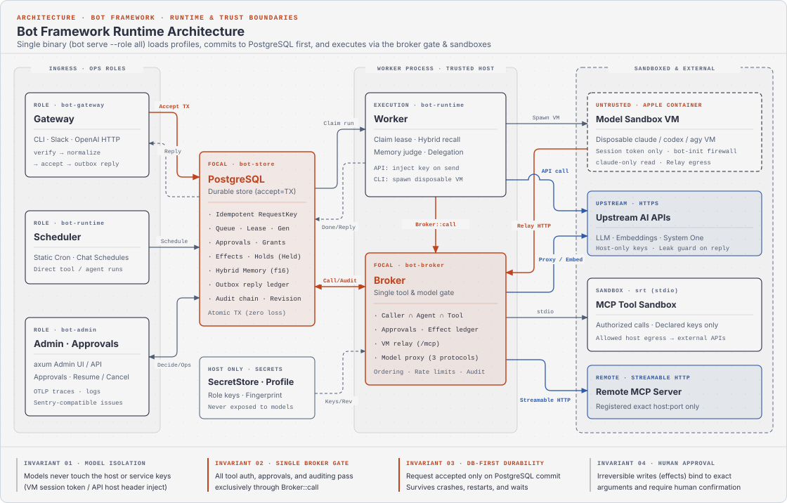
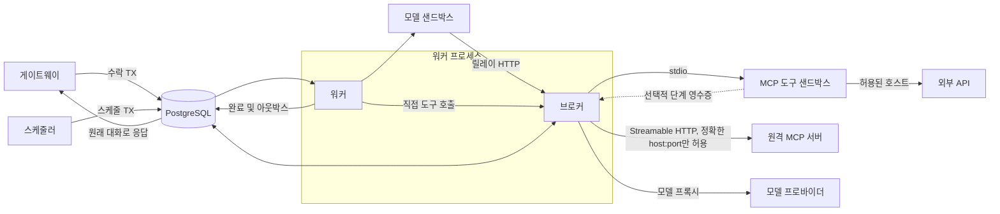
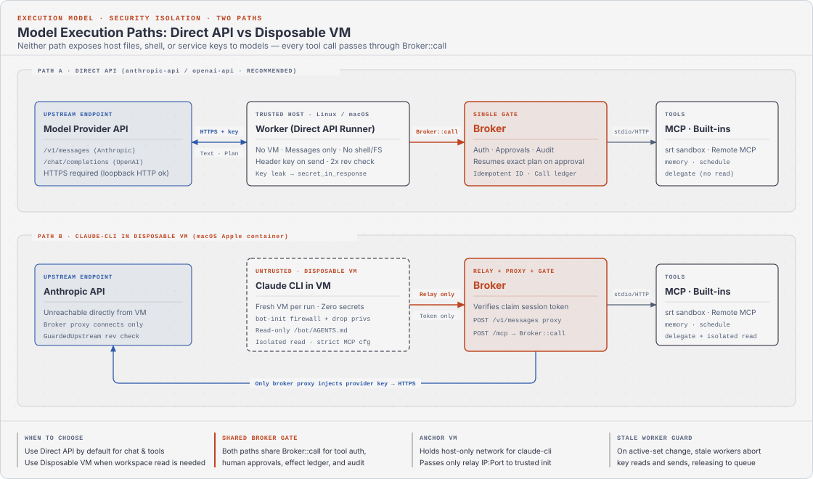
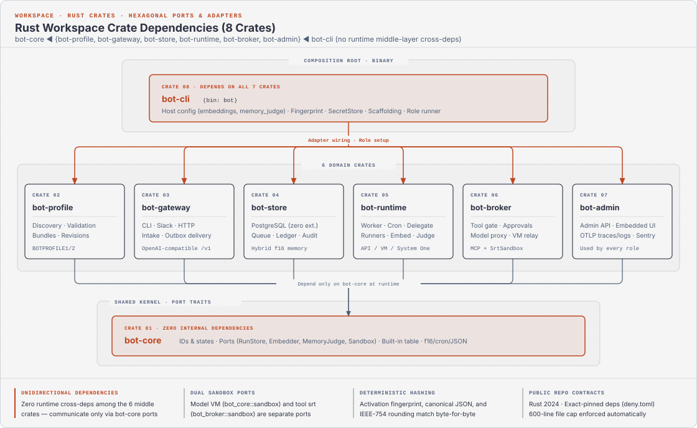

# 아키텍처

[English](../architecture.md) | 한국어

단일 바이너리가 선언적 프로필을 로드해 각 요청을 대상 에이전트로 라우팅하고, 단일 브로커 게이트를 통해 도구를 실행한 뒤, 원래 대화로 응답을 전달합니다.

예를 들어 로컬 CLI 사용자가 오늘 일정을 물으면 게이트웨이가 신원을 검증해 요청을 PostgreSQL에 커밋하고, 워커가 이를 `main` 에이전트용으로 선점(claim)하며, 모델이 `agenda.list`를 요청할 때 브로커가 권한을 검사하고 샌드박스 안에서 도구를 실행합니다. 스케줄 트리거도 같은 브로커 경로를 통해 도구를 직접 호출할 수 있습니다.

<picture>
  <source media="(prefers-color-scheme: dark)" srcset="../diagrams/runtime-architecture-dark.svg">
  <source media="(prefers-color-scheme: light)" srcset="../diagrams/runtime-architecture-light.svg">
  
</picture>

텍스트 흐름 다이어그램 (Mermaid)

## 런타임 역할

한 호스트에서 `bot serve --role all`로 네 역할을 함께 실행하거나, `--role gateway`, `--role scheduler`, `--role worker`, `--role admin`으로 프로세스를 분리할 수 있습니다. 브로커는 워커 프로세스 내부에서 동작합니다.

- **Gateway:** CLI, Slack, HTTP 요청을 검증하고 신원·프로필·요청 ID·응답 대상으로 정규화한 뒤, PostgreSQL 커밋이 완료된 후에만 수락(ack)을 반환합니다. 아웃박스 응답을 전달할 때는 `SecretStore`에서 자체 어댑터 자격 증명을 읽습니다.
- **Scheduler:** 도래한 각 스케줄 틱마다 실행을 커밋합니다.
- **Worker:** 대기 중인 실행을 선점(claim)하고 모델 턴 또는 직접 도구 호출을 실행합니다. 자식 위임 시에는 원래 주체(principal)와 응답 대상을 유지하되 스코프를 좁혀 전달하며, 부모는 대기 중 리스를 반납했다가 자식의 완료·실패·취소 시 재개합니다.
- **Broker:** 단일 권한 검증·승인·감사 게이트(`Broker::call`)입니다. 로컬 MCP 서버를 `srt` 안에서 실행하거나 호스트에 등록된 원격 Streamable HTTP 서버에 직접 연결합니다([MCP 도구](plugins.md)). 또한 VM 기반 CLI의 업스트림 모델 호출을 프록시합니다.
- **Store & Admin:** `bot-store`는 접수, 큐, 메모리, 승인, 영수증, 아웃박스 행을 PostgreSQL에 저장합니다. `bot-admin`은 호출자 권한 범위로 제한된 axum Admin UI/API를 제공하고, OTLP 트레이스/로그(요청·자식·시도·도구 ID 연결) 및 Sentry 호환 이슈를 내보내며, 수집기가 실패하더라도 원장 내구성에는 영향을 주지 않습니다.

8가지 핵심 개념인 **프로필**(격리 단위), **에이전트**(역할 폴더), **스킬**(지침 + 도구), **게이트웨이**(인그레스/이그레스), **트리거**(실행 조건), **실행(run)**(작업 단위), **브로커**(도구 게이트), **이펙트**(외부 쓰기)와 크레이트별 코드 식별자는 [용어집](glossary.md)에 정리되어 있습니다.

### VM 호스팅 모델 CLI가 브로커에 연결하는 방식

VM CLI 모드(`claude-cli`, `codex-cli`, `agy-cli`)에서 워커는 공유 앵커 VM을 통해 호스트 전용 네트워크를 유지하고, 릴레이 리스너의 실제 IP와 TCP 포트를 모델 VM 내부의 신뢰할 수 있는 `bot-init`에 전달합니다. 사설 네트워크는 다른 호스트 포트나 피어 VM에도 도달할 수 있으므로, `bot-init`은 먼저 VM 방화벽을 설정하고 권한을 강등한 뒤 고정된 모델 CLI를 실행합니다. 모든 릴레이 요청은 현재 실행의 활성 리스(`claim`)와 해당 별칭의 와이어 프로토콜에 바인딩된 세션 토큰으로 인증됩니다.

워커는 에이전트 지침, 스킬 본문, 운영자 지식 문서를 읽기 전용 `/bot/AGENTS.md`로 조합합니다(`claude-cli`는 `--append-system-prompt-file /bot/AGENTS.md`로, `codex-cli`와 `agy-cli`는 `/bot`에서 자동 로드하며 `agy-cli`는 24 KB 규칙 제한을 넘기지 않도록 필요 시 도구 스키마를 stdin으로 넘깁니다). 회상된 메모리는 구성원이 편집할 수 있으므로 출처 태그를 붙여 신뢰된 시스템 지침이 아닌 사용자 입력으로 주입합니다.

| CLI 러너 | 모델 릴레이 경로 | 도구 릴레이 및 인증 | 복구 및 재개 |
|---|---|---|---|
| `claude-cli` | `POST /v1/messages` (`Anthropic`, `ANTHROPIC_BASE_URL` / `ANTHROPIC_API_KEY`) | `/work/mcp.claude.json`(`Bearer ${RELAY_TOKEN}`)으로 `POST /mcp` 호출; `_meta["claudecode/toolUseId"]` 매칭. | 감사된 JSONL 세션 추적 + 브로커 회상 도구 출력으로 `--resume`. |
| `codex-cli` | `POST /v1/responses` (`OpenAiResponses`, `Authorization: Bearer ${RELAY_TOKEN}`) | `mcp_servers.relay.bearer_token_env_var="RELAY_TOKEN"`으로 `POST /mcp` 호출; `_meta["callId"]` 매칭. | 감사된 롤아웃 JSONL 추적 + 브로커 회상 도구 출력으로 `codex exec resume`. |
| `agy-cli` | `POST /v1beta/models/<model>:streamGenerateContent` (`Gemini`, `GOOGLE_GEMINI_BASE_URL` / `GEMINI_API_KEY`) | `bot-init`이 `/work/mcp.agy.template.json`에서 RAM 전용 `/tmp/mcp_config.json`으로 확장한 심볼릭 링크를 통해 `POST /mcp` 호출; 브로커가 `call_mcp_tool` 계획을 `_meta["progressToken"]` 기준 FIFO로 매칭. | 브로커가 `cli-group-*` / `cli-use-*`를 직접 커밋하며, 대기/재개 시 원장 슬롯을 정산하고 렌더링된 대화 기록으로 새 세션을 시작. |

모든 CLI 모드에서 브로커는 업스트림 프록시 구간에서만 실제 프로바이더 키를 주입하고, 도구 목록 조회 시에도 활성 claim을 검증하며, 모든 `/mcp` 호출을 브로커가 관찰한 모델 턴과 대조해 결정적 호출 ID를 부여하고, 워커 종료 시 자신이 발급한 토큰만 폐기합니다. ([신뢰성](reliability.md))

## 호스트 설정 및 모델 실행

`BOT_HOST_CONFIG`에서 `models`는 프로필별로 허용되는 모델 별칭을 선언하고, `providers`는 각 별칭의 실행 방식을 정의합니다. 예를 들어 외부 계정 없는 로컬 데모에서는 `{"models":{"personal":["assistant"]},"providers":{"assistant":{"kind":"demo"}}}`를 사용합니다. VM CLI 프로바이더(`claude-cli`, `codex-cli`, `agy-cli`)는 업스트림 `model`, HTTPS `endpoint`, 프로필 시크릿 이름 `secret`이 필수이며, 선택적으로 `effort`(`low`, `medium`, `high`, `xhigh`, `max`; 기본값 `medium`)를 지정할 수 있습니다.

### 모델 러너 선택

일반 대화와 브로커 도구 호출에는 기본적으로 직접 API 러너(`anthropic-api`, `openai-api`)를 사용하세요. CLI 에이전트 하니스가 필요하거나(또는 에이전트가 격리된 `/bot` 파일 읽기를 위해 `builtin: [read]`를 선언한 `claude-cli`인 경우) Apple `container` VM 기반 CLI 러너(`claude-cli`, `codex-cli`, `agy-cli`)를 사용합니다.

<picture>
  <source media="(prefers-color-scheme: dark)" srcset="../diagrams/model-execution-paths-dark.svg">
  <source media="(prefers-color-scheme: light)" srcset="../diagrams/model-execution-paths-light.svg">
  
</picture>

| 러너 | 워커 호스트 | 모델 프로세스 | 프로바이더 키 처리 | 사용 가능한 내장 도구 |
|---|---|---|---|---|
| `anthropic-api`, `openai-api` | Linux, macOS | 없음 — 워커가 VM 없이 업스트림 HTTP API를 직접 호출합니다. | 요청 전송 직전에 `SecretStore`에서 읽어 요청 헤더에 첨부합니다. 루프백 엔드포인트에서만 생략할 수 있습니다. | 스코프 제한 `memory.share`, `memory.search`, `memory.save`, `memory.forget`, `schedule.create`, `schedule.list`, `schedule.cancel`; 슈퍼 관리자 전용 `skill.inspect`, `skill.create`, `skill.update`, `skill.delete`, `mcp.add`, `mcp.remove`; 직계 자식용 `delegate`. 파일 내장 도구를 선언하면 `unsupported_builtin`으로 영구 실패합니다. |
| `claude-cli` | Apple `container`가 설치된 macOS | 브로커 릴레이에 연결된 일회용 VM에서 Claude Code를 실행합니다. | 호스트 브로커의 모델 프록시만 읽으며, VM에는 세션 토큰만 전달합니다. | 위 모든 도구에 더해, 프로필이 허용한 경우 격리 기반 `read`를 사용할 수 있습니다. |
| `codex-cli`, `agy-cli` | Apple `container`가 설치된 macOS | 브로커 릴레이에 연결된 일회용 VM에서 Codex CLI 또는 Antigravity CLI를 실행합니다. | 호스트 브로커의 모델 프록시만 읽으며, VM에는 세션 토큰만 전달합니다. | 위 모든 브로커 도구. 파일 내장 도구(`read`, `grep`, `glob`)를 선언하면 `unsupported_builtin`으로 실패합니다. |

호스트는 발화별 전달 승인을 위해 `schedule.deliver`를 예약합니다. ([MCP 도구](plugins.md))

### 직접 API 러너

단계별(staged) 워커는 각 턴에서 계획된 도구 호출을 저장합니다. 호출 중 하나가 승인을 대기하면 재개 시 동일한 계획을 재생하고, 실행 전 거부는 호출 ID 기준으로 재생합니다. 위임 외의 도구는 CLI 프런트와 같은 `Broker::call` 게이트를 통과합니다. ([신뢰성](reliability.md))

- **엔드포인트 및 파라미터:** `anthropic-api`는 `POST {endpoint}/v1/messages`(Anthropic Messages)로, `openai-api`는 `POST {endpoint}/chat/completions`(`endpoint`에 `/v1` 포함; OpenAI, Gemini 호환, Ollama, vLLM 지원)로 요청합니다. 예: `{"kind":"anthropic-api","model":"<upstream-id>","endpoint":"https://api.anthropic.com","secret":"<secret-name>","max_tokens":4096,"effort":"medium"}`.
  - 출력 상한: `max_tokens`, 또는 `openai-api`에서는 `max_completion_tokens`(둘 중 최대 하나만 지정; 그대로 전송하므로 최신 OpenAI 모델은 `max_completion_tokens`, 호환 서버는 `max_tokens`를 사용 가능).
  - 선택적 `effort`(`low`, `medium`, `high`, `xhigh`, `max`): `anthropic-api`에서는 `output_config.effort`, `openai-api`에서는 `reasoning_effort`로 매핑되며 미설정 시 생략됩니다.
- **대상 주소 및 구버전 리비전 가드:** `https`만 허용되며, 루프백 IP 리터럴(`127.0.0.0/8`, `::1`, 예: 로컬 Ollama)에 한해 `http`를 허용합니다. 호스트명 `localhost`, 사설 LAN `http`, 임베드된 자격 증명(`user@`), 쿼리, 프래그먼트는 설정 로드 시 거부되며, `secret`은 루프백에서만 선택 사항입니다. 프로바이더 `kind`, `model`, 전체 기본 `endpoint`, `secret` 이름은 활성화 지문에 포함됩니다(`max_tokens`, `max_completion_tokens`, `effort`는 미포함). 워커는 시크릿을 읽기 전과 전송 직전 **두 번** 스토어에서 활성 리비전을 검증합니다(프록시 경로의 `GuardedUpstream`과 동일하며 I/O 중 가드를 점유하지 않음). 구버전 워커는 읽은 키를 폐기하고 전송을 건너뛰며 일시적 오류 `stale_worker`를 보고해 큐가 깔끔하게 재할당하도록 합니다.
- **전송 및 유출 방지:** 리다이렉트, 숨은 재시도, 커넥션 풀링은 비활성화되어 있으며 연결·전체(`Limits::total`)·응답 본문 제한과 취소 중단이 적용됩니다. 요청 시크릿이 업스트림 응답 어디에든(원본 또는 이스케이프 해제 형태 — 최종 텍스트, 동반 텍스트, 인자, 프로바이더 상태) 나타나면 아무것도 체크포인트하거나 브로커로 보내지 않고 `secret_in_response`로 실패합니다.
- **오류 분류 (러너 내부 재시도 없음; 워커 정책이 결정):**

| 실패 분류 | 고정 코드 | 발생 조건 |
|---|---|---|
| 일시적(Transient) | `rate_limited`, `overloaded`, `network`, `timeout` | HTTP 429(할당량 초과 제외), 5xx, 408, 연결 실패, 타임아웃 |
| 영구적(Permanent) | `upstream_rejected`, `upstream_auth`, `upstream_redirect`, `invalid_response`, `output_limit`, `refused`, `content_filter` | HTTP 400/404/기타 4xx, 401/403, 3xx, 잘못된 페이로드, `error.code`/`error.type`이 `insufficient_quota`/`quota_exhausted`인 HTTP 429, 출력 잘림(`max_tokens`/`length`), `refusal`, 콘텐츠 필터 |

오류 본문은 분류 목적으로만 최대 16 KiB까지 읽으며 로그나 저장소에 남기지 않습니다. 로그에는 HTTP 상태와 허용 목록의 고정 사유 코드만 기록합니다. 잘린 도구 호출은 절대 실행하지 않습니다.

- **도구 이름 매핑 및 스키마 검증:** 요청마다 도구 ID는 `^[a-zA-Z0-9_-]{1,64}$` 범위로 가역 매핑됩니다. Anthropic Messages에서는 업스트림 호환성을 위해 `input_schema` 최상위의 `oneOf`/`allOf`/`anyOf` 조합자를 분기 속성과 공통 필수 키로 평탄화하지만, 브로커는 실제 호출 인자를 원래의 전체 스키마로 계속 검증합니다. 매핑되지 않은 이름(`unknown_tool`), 누락·비객체·크기 초과·중복 키 인자(`invalid_tool_args`), 과도한 호출 수(`too_many_calls`), 중복 업스트림 호출 ID(`invalid_response`), 또는 Anthropic이 `tool_use`로 종료하지 않았는데 `tool_use` 블록이 포함된 응답은 해당 턴의 호출을 하나도 실행하지 않고 영구 실패합니다(인자를 `{}`로 기본 채움하지 않음).
- **신뢰 경계:** 조합된 시스템 지침만 system 역할에 들어가며, 사용자 메시지·`tool_result`/`tool` 출력·회상된 메모리는 user/tool 역할에 머뭅니다.
- **사용량 집계:** 업스트림이 명시적으로 보고한 토큰만 기록합니다(0으로 채우지 않음). 모든 모델 호출이 사용량을 보고했고, 실행이 첫 번째 claim이며, 위임이 실제로 자식을 생성하지 않았을 때만 총합을 저장합니다. 사용량을 보고하지 않은 호출은 `worker.model` 스팬에서 토큰 속성을 생략합니다. 턴별 카운트는 승인 체크포인트를 거쳐도 유지됩니다.
- **불투명 프로바이더 상태:** 업스트림 호출 ID와 추론 상태(OpenAI 호환 Gemini의 `extra_content.google.thought_signature`, Anthropic의 `thinking`/`redacted_thinking` 블록과 `tool_use` ID)는 멱등 워커 호출 ID와 함께 불투명하게 저장되며 프로바이더 지문(`kind`, 기본 URL, `model`, `secret`)에 바인딩됩니다. 일시 중지 중 별칭 대상이 바뀌면 이전 프로바이더 상태는 새 업스트림으로 전달하지 않습니다. 크기 제한을 초과한 추론/서명 페이로드는 호출을 실행하기 전에 `unsupported_tool_signature`로 영구 실패합니다.

### 호스트 설정 요약

| 설정 | 용도 및 기본값 |
|---|---|
| `sandbox.srt.binary`, `work_root`, `extra_path` | `srt` 바이너리와 읽기 전용 도구 설치/작업 루트의 절대 경로. 선택적 `extra_path`는 최대 16개의 호스트 절대 디렉터리(예: `/opt/homebrew/bin`)를 샌드박스 도구의 `PATH`에 추가합니다. |
| `limits.tool_call_max_secs` | 도구별 `timeout_secs`의 선택적 상한(초 단위; 기본 `60`, 최대 `900`). 상한을 높여도 `timeout_secs`를 생략한 도구의 기본값 60초는 올라가지 않습니다. 활성화 지문에 포함됩니다. ([MCP 도구](plugins.md)) |
| `embeddings` (`endpoint`, `model`, `secret`, `dimensions`) | 하이브리드 메모리 회상(유니코드 어휘·트라이그램 + 정규화된 IEEE-754 `f16` 코사인 + RRF + 최신성 가중치, 추가 확장 없는 기본 PostgreSQL 사용)을 위한 선택적 OpenAI 호환 `/embeddings` API 설정. 예: `{"endpoint":"https://generativelanguage.googleapis.com/v1beta/openai","model":"gemini-embedding-2","secret":"gemini-api-key","dimensions":3072}`. `dimensions` 기본값은 `3072`(`1..=4096`)이며, `secret`은 루프백 IP 엔드포인트에서만 생략할 수 있고, 미설정 시 어휘 회상으로 폴백합니다. 설정 시 활성화 지문에 포함됩니다. |
| `sandbox.apple.image`, `sandbox.apple.images`, `sandbox.apple.network` | CLI 워커용 다이제스트 고정 VM 이미지와 호스트 전용 네트워크 이름(공유 앵커 VM 1대가 호스트 인터페이스를 유지). `sandbox.apple.images`는 CLI별 키(`claude`, `codex`, `agy`)를 다이제스트 고정 참조에 매핑합니다(`claude`는 `sandbox.apple.image`로 폴백하며 `codex`와 `agy`는 명시적 키가 필요). 활성화 지문에 포함됩니다. |
| `sandbox.apple.relay_bind` | 선택적 워커 로컬 릴레이 바인드 주소. 기본값은 앵커 VM 게이트웨이 IPv4 + OS 할당 포트이며, 지정 시 해당 게이트웨이 IP와 일치해야 합니다. |
| `sandbox.apple.work_root` | 선택적 워커 로컬 모델 작업 디렉터리 절대 경로(`0700`). 기본값은 `<tool-root-parent>/work/models`입니다. |
| `sandbox.apple.instance` | 선택적 워커 로컬 VM 이름 접두사(기본값 `botvm`). |
| `sandbox.apple.binary` | 선택적 워커 로컬 Apple `container` 바이너리 절대 경로(기본값 `container`). |
| `bot/<profile>/private-intake` | 프라이빗 DM을 받는 게이트웨이에 필요한 프로필별 지문 키(설정된 도구 러너와 함께 사용). 도구 환경 변수에는 절대 주입되지 않습니다. |
| `admin.trace`, `admin.logs`, `admin.issues` | OTLP 트레이스/로그 및 Sentry 호환 이슈 익스포터 설정(엔드포인트, 헤더, 시크릿, 레벨, 콘텐츠 플래그, ID 형식, 샘플링 비율). 활성화 지문에 포함되므로 변경·제거 시 구버전 프로세스의 내보내기를 멈추기 위해 재활성화가 필요합니다. ([관리자 및 관측성](admin.md)) |

Rust 어댑터는 릴레이 리스너의 실제 주소에서 `BOT_RELAY_IP`(RFC 1918 IPv4), `BOT_RELAY_PORT`(`1..=65535`) 및 CLI별 릴레이 기본 URL(`claude-cli`는 `ANTHROPIC_BASE_URL`, `codex-cli`는 `model_providers.relay.base_url` / `mcp_servers.relay.url`, `agy-cli`는 `GOOGLE_GEMINI_BASE_URL`)을 호스트 측에서만 파생합니다. 모델 VM은 `bot-init`으로 부팅하고, 앵커 VM은 UID:GID `10001:10001`로 `bot-anchor`를 실행합니다. ([모델 이미지](model-image.md))

데모 모델은 VM이나 업스트림 키가 필요 없지만, 데모 도구는 운영 도구와 동일한 설치·샌드박스·승인 규칙을 그대로 적용합니다.

## Rust 워크스페이스 크레이트

<picture>
  <source media="(prefers-color-scheme: dark)" srcset="../diagrams/crate-dependencies-dark.svg">
  <source media="(prefers-color-scheme: light)" srcset="../diagrams/crate-dependencies-light.svg">
  
</picture>

| 크레이트 | 책임 | 내부 의존성 |
|---|---|---|
| `bot-core` | 공통 ID, 상태 타입, 포트 트레이트, 내장 도구 테이블, 결정적 알고리즘 | 없음 |
| `bot-profile` | 프로필 탐색, 검증, 번들 패킹, 리비전 생성 | `bot-core` |
| `bot-store` | PostgreSQL 큐, 호출/이펙트 원장, 승인, 아웃박스, 감사 체인 | `bot-core` |
| `bot-runtime` | 워커 루프, 스케줄러, 위임, 직접 API(`anthropic-api`, `openai-api`) 및 Apple `container` VM CLI 러너 | `bot-core` |
| `bot-broker` | 도구 권한 검증, 승인, 모델 프록시, VM 릴레이, `srt` 샌드박스 MCP 러너 | `bot-core` |
| `bot-gateway` | CLI, Slack, HTTP(OpenAI 호환) 접수 및 아웃박스 전달 | `bot-core` |
| `bot-admin` | Admin API/UI 및 OTLP 트레이스/로그 + Sentry 호환 이슈 익스포터(모든 역할에서 사용) | `bot-core` |
| `bot-cli` | `bot` 바이너리, 호스트 설정, `SecretStore` 구현, 역할 배선 | 위 7개 전체 |

공통 상위 트레이트가 없는 두 개의 독립된 샌드박스 포트가 존재합니다. `ContainerSandbox`는 모델 VM용 `bot_core::sandbox::Sandbox<ModelSpec>`을 구현하고, `SrtSandbox`는 MCP 도구용 `bot_broker::sandbox::Sandbox`를 구현하며, `bot-cli`가 각 어댑터를 독립적으로 주입합니다.

런타임 환경 변수는 `BOT_` 접두사를 사용하며, 프로필 디렉터리는 `BOT_PROFILES`로 지정합니다. 공개 워크스페이스에는 하드코딩된 프로필 이름, 경로, 비공개 식별자가 없습니다.
